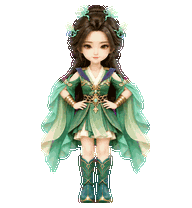
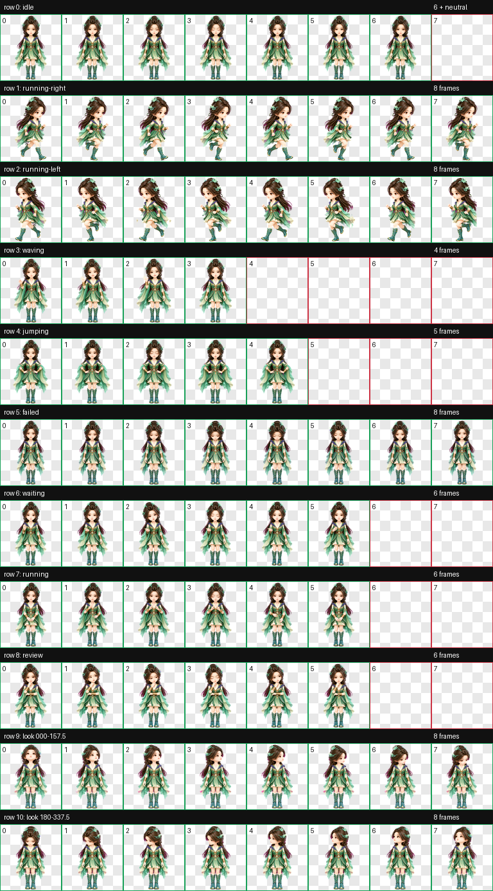
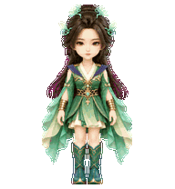
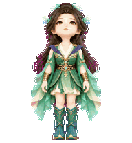

# 菡云芝（Han Yunzhi）

适用于 Codex Desktop 的《凡人修仙传》动漫菡云芝 Q 版动态桌宠。采用用户确认的严格正面直立形象，保留黑褐半束长发、青玉藤叶发饰、暖棕眼睛、绿衣紫肩、浅色交领、金色胸腰饰与护腕，以及青色长靴。比例、面部精细度、材质与光照参考柳玉，角色身份依据用户提供的四张参考图。

`jumping` 按用户要求定制为正面双手叉腰：双手始终放在腰带两侧，双肘自然向外，双腿伸直、双脚落地；5 帧通过轻微呼吸、眨眼和衣料变化形成循环。



## 动作总览



| 状态 | 效果 |
| --- | --- |
| `idle` | 正面站立，安静呼吸、眨眼与衣料微动 |
| `running-right` | 面向屏幕右侧移动，步态交替并保持待机尺度 |
| `running-left` | 逐帧镜像向右移动，保留时间顺序与角色尺度 |
| `waving` | 抬手、轻挥、收手的温和问候 |
| `jumping` | 正面双手叉腰，双脚落地，轻微呼吸与眨眼 |
| `failed` | 微微低头、垂眸、肩部放松后恢复 |
| `waiting` | 摊手、歪头与眨眼，期待用户输入 |
| `running` | 专注眼神与小幅手势表现任务处理 |
| `review` | 手靠下巴、观察与眨眼，审阅结果 |
| Look directions | 16 个顺时针观察方向，眼球与头颈自然转动，下半身稳定 |






## 安装

在仓库根目录运行 PowerShell：

```powershell
$target = Join-Path $HOME ".codex\pets\han-yunzhi"
New-Item -ItemType Directory -Path $target -Force | Out-Null
Copy-Item .\han-yunzhi\pet.json, .\han-yunzhi\spritesheet.webp -Destination $target -Force
```

复制完成后重启 Codex Desktop，在 pet 选择界面选择“菡云芝”。安装仅需 `pet.json` 与 `spritesheet.webp`。

## 文件结构

```text
han-yunzhi/
|-- README.md
|-- pet.json
|-- spritesheet.webp
|-- assets/
|   |-- base-front.png
|   |-- contact-sheet.png
|   |-- idle.gif
|   |-- jumping.gif
|   |-- running-right.gif
|   |-- running-left.gif
|   |-- waving.gif
|   |-- failed.gif
|   |-- waiting.gif
|   |-- running.gif
|   |-- review.gif
|   `-- look-directions.gif
`-- source/
    |-- han-yunzhi-20261014-base/        # 角色参考、选型与正面站姿修订
    `-- han-yunzhi-20261014-production/  # 独立生产基本图、动作与 QA
```

[用户批准的正面形象](assets/base-front.png) 原样保留。生产基本图独立生成并经身份、比例、主体占比、纯色背景与小尺寸可读性检查后，才作为 canonical 动画输入。背景使用纯洋红 `#FF00FF`，通过 `hatch-pet` 的确定性脚本处理。

## 规格与验证

| 项目 | 数值 |
| --- | --- |
| Sprite 版本 | 2 |
| 图集尺寸 | 1536 × 2288 |
| 网格 | 8 列 × 11 行 |
| 单帧尺寸 | 192 × 208 |
| 格式 | RGBA 无损 WebP，透明背景 |
| 标准状态 | 9 套 |
| 观察方向 | 16 个顺时针方向 |

通过 `validate_atlas.py --require-v2` 校验，图集结构、透明背景、使用帧与未使用单元格均符合合同；确定性边缘处理报告 `ok: true`。9 套标准状态通过结构与逐帧视觉 QA，`jumping` 全部 5 帧双手叉腰、双脚落地。方向部分完成四方位基准、两行确定性注册、逐方向语义、三份独立盲测、相邻连续性及最终独立视觉 QA。

移动动作采用紧凑的交替步态。细微方向与连续性警告以正常显示尺寸的有序循环复核为准，具体记录保留在本地 QA 工程中。

三份独立盲测在 14 组横纵轴方向对上判断一致，验证无错误、无警告。两处跨行循环接缝的差异指标，以及靴子和垂袖之间的透明空间提示，经独立逐帧视觉检查均属于可接受变化，没有明显跳动、角色缩放或填充身体内部的透明裂缝。

所有视觉由内置 `imagegen` 生成；帧提取、图集组装、透明背景与边缘处理、校验及预览由 `hatch-pet` 的确定性脚本完成。发布 GIF 从最终清理后的图集提取，使用该 skill 的预览函数编码。生成提示词、参考图、被拒收版本、校验、盲测和连续性记录均在 `source/` 保留；该目录按仓库约定仅保存在本地，不参与安装。
