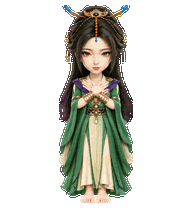
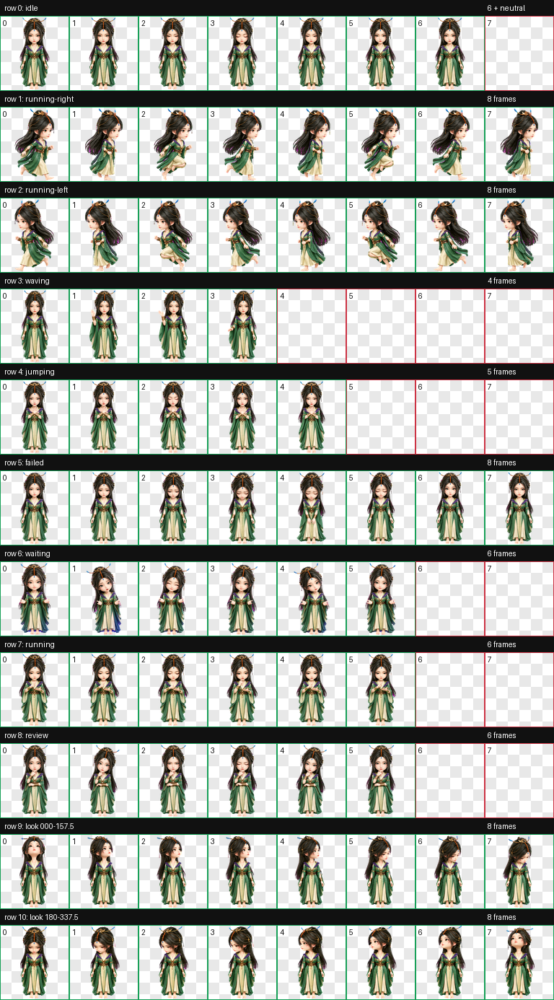
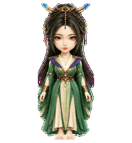
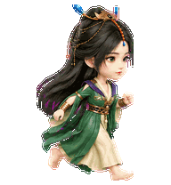
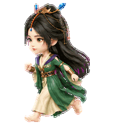
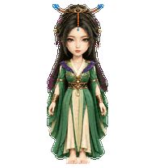
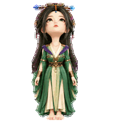

# 柳玉（Liu Yu）

适用于 Codex Desktop 的《凡人修仙传》动漫柳玉 Q 版动态桌宠。采用用户确认的正面形象，保留黑色半束长发、蓝尖金铜发冠、额前琥珀珠链与蓝色水滴坠饰、灰绿色眼睛，以及绿衣、紫色披肩、浅色交领、金铜腰饰与护腕。

`jumping` 按用户要求定制为正面双手交叉放在胸前：两只手掌放松地交叉搭在对侧上胸，双脚始终落地，5 帧以轻微呼吸、眨眼和手部起伏形成循环。



## 动作总览



| 状态 | 效果 |
| --- | --- |
| `idle` | 安静呼吸、眨眼与衣料轻微变化 |
| `running-right` | 保持待机尺度向屏幕右侧移动，步态交替 |
| `running-left` | 逐帧镜像向右移动，保持时间顺序与身体尺度 |
| `waving` | 抬手、轻挥、收手的温和问候 |
| `jumping` | 双手交叉放在上胸，双脚落地，轻微呼吸与眨眼 |
| `failed` | 低头、闭眼、肩部微垂后恢复 |
| `waiting` | 摊手、歪头、眨眼，等待用户输入 |
| `running` | 用手势与专注眼神表现任务处理 |
| `review` | 托腮、歪头与眨眼，审阅结果 |
| Look directions | 16 个顺时针观察方向，眼睛与头部自然转动，下半身保持稳定 |











## 安装

在仓库根目录运行 PowerShell：

```powershell
$target = Join-Path $HOME ".codex\pets\liuyu"
New-Item -ItemType Directory -Path $target -Force | Out-Null
Copy-Item .\liuyu\pet.json, .\liuyu\spritesheet.webp -Destination $target -Force
```

复制完成后重启 Codex Desktop，在 pet 选择界面选择“柳玉”。安装仅需 `pet.json` 与 `spritesheet.webp`。

## 文件结构

```text
liuyu/
|-- README.md
|-- pet.json
|-- spritesheet.webp
|-- assets/
|   |-- base-front.png
|   |-- contact-sheet.png
|   |-- idle.gif
|   |-- jumping.gif
|   |-- running-left.gif
|   |-- running-right.gif
|   |-- waving.gif
|   `-- look-directions.gif
`-- source/
    |-- liuyu-20261013/              # 用户批准的形象稿与原始参考
    `-- liuyu-20261013-production/   # 生产输入、中间产物与 QA 证据
```

[已批准的正面形象](assets/base-front.png) 原样保留。另行生成的生产基本图保持同一身份、服装与头身比例，调整安全边距，并使用 `hatch-pet` 的确定性背景处理函数统一成纯洋红；通过身份、比例、主体占比及 `192 × 208` 可读性检查后才晋升为动画基准。

## 规格与验证

| 项目 | 数值 |
| --- | --- |
| Sprite 版本 | 2 |
| 图集尺寸 | 1536 × 2288 |
| 网格 | 8 列 × 11 行 |
| 单帧尺寸 | 192 × 208 |
| 格式 | RGBA 无损 WebP，透明背景 |
| 标准状态 | 9 套 |
| 观察方向 | 16 个顺时针方向 |

通过 `validate_atlas.py --require-v2` 校验，图集结构、透明背景和未使用单元格均无错误；确定性边缘处理报告 `ok: true`，且保留原有 alpha。9 套状态已完成逐帧结构与动作视觉检查；16 方向已完成标注语义、三份隔离盲测多数表决、相邻连续性与最终独立视觉 QA。盲测共识全部方向对通过，无错误或未确认项。

部分相邻中间角度差异细微，已按有序循环复核为正确象限；跨行差异指标与冠饰附近透明区域也已复核，分别属于自然转头变化与发冠负空间，没有身份漂移、明显缩放跳变或身体内部透明裂缝。标准帧脚底基线一致，`jumping` 全部 5 帧双脚落地。

所有视觉素材由内置 `imagegen` 生成；图集组装、背景与透明边缘处理、校验和预览由 `hatch-pet` 的确定性脚本完成。完整提示词位于本地生产工程的 `prompts/`，作业清单位于 `imagegen-jobs.json`。

`source/` 按仓库规则仅保留在本地，不参与日常安装。生成提示词、参考图、被拒收的方向或尺度版本、结构校验、方向语义、盲测与连续性报告均保留以便追溯。
