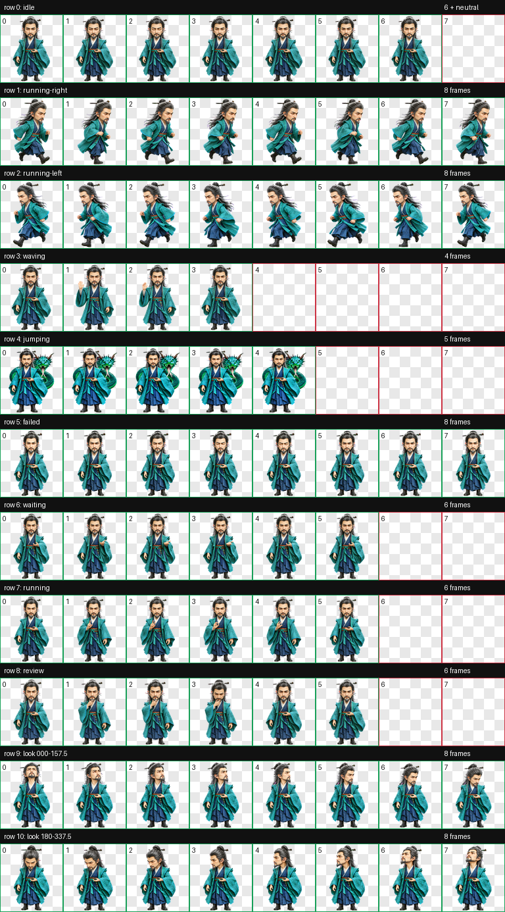
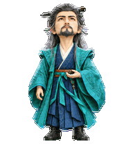

# 魏无涯（Wei Wuya）

适用于 Codex Desktop 的《凡人修仙传》动漫魏无涯 Q 版动态桌宠。采用用户确认的正面形象，保留灰黑长发、发簪、灰眉与胡须、青绿宽袖法袍、深色内袍、腰带与长靴。

`jumping` 按用户要求定制为站立召蛟：人物正面托掌、双脚落地，毒蛟正面对镜头，头部位于画面右侧肩后，蛇身在背后盘绕；5 帧以轻微呼吸、盘绕和口舌变化形成循环，人物保持待机尺度。


## 动作总览



| 状态 | 效果 |
| --- | --- |
| `idle` | 正面腰前托掌，安静呼吸与眨眼 |
| `running-right` | 面向屏幕右侧移动，交替步态并保持待机尺度 |
| `running-left` | 面向屏幕左侧移动，单独生成以保留饰品侧别 |
| `waving` | 抬手、轻挥、收手的克制问候 |
| `jumping` | 正面托掌站立，毒蛟正面朝向镜头并在背后盘绕 |
| `failed` | 含蓄低头、收掌与失落反应 |
| `waiting` | 托掌向前，期待用户确认或帮助 |
| `running` | 站定掐指计算，集中处理任务 |
| `review` | 抚须托腮，集中审视结果 |
| Look directions | 16 个顺时针观察方向，眼睛与头颈自然转动，下半身稳定 |




## 安装

在仓库根目录运行 PowerShell：

```powershell
$target = Join-Path $HOME ".codex\pets\wei-wuya"
New-Item -ItemType Directory -Path $target -Force | Out-Null
Copy-Item .\wei-wuya\pet.json, .\wei-wuya\spritesheet.webp -Destination $target -Force
```

复制完成后重启 Codex Desktop，在 pet 选择界面选择“魏无涯”。安装仅需 `pet.json` 与 `spritesheet.webp`。

## 文件结构

```text
wei-wuya/
|-- README.md
|-- pet.json
|-- spritesheet.webp
|-- assets/
|   |-- base-v2.png
|   |-- contact-sheet.png
|   |-- idle.gif
|   |-- jumping.gif
|   |-- running-right.gif
|   |-- running-left.gif
|   |-- waving.gif
|   |-- failed.gif
|   |-- waiting.gif
|   |-- running.gif
|   |-- review.gif
|   `-- look-directions.gif
`-- source/
    |-- wei-wuya-20261014/                      # 用户批准的形象稿与原始参考
    |-- wei-wuya-20261014-production/           # 独立生产基本图、动作与 QA
    |-- ...                                    # 本地中间工程
    `-- wei-wuya-20261014-dujiao-standing-final/ # 站立召蛟定稿与最终 QA
```

[用户批准的正面形象](assets/base-v2.png) 原样保留。生产基本图独立生成并经身份、比例、主体占比、纯色背景与小尺寸可读性检查后，才作为 canonical 动画输入。背景使用纯洋红 `#FF00FF`，通过 `hatch-pet` 的确定性脚本处理。

## 规格与验证

| 项目 | 数值 |
| --- | --- |
| Sprite 版本 | 2 |
| 图集尺寸 | 1536 × 2288 |
| 网格 | 8 列 × 11 行 |
| 单帧尺寸 | 192 × 208 |
| 格式 | RGBA 无损 WebP，透明背景 |
| 标准状态 | 9 套 |
| 观察方向 | 16 个顺时针方向 |

通过 `validate_atlas.py --require-v2` 校验，图集结构、透明背景、使用帧与未使用单元格均符合合同；确定性边缘处理报告 `ok: true`。9 套标准状态通过结构与逐帧视觉 QA，`jumping` 全部 5 帧双脚落地，人物身高、头部大小与脚底基线和待机一致。方向部分完成四方位基准、两行确定性注册、逐方向语义、三份独立盲测、相邻连续性及最终独立视觉 QA。

三份独立盲测在 14 组横纵轴方向对上判断一致，验证无错误、无警告。

部分相邻斜向姿态差异细微，已按正常显示尺寸的有序循环复核；站立毒蛟帧间轻微材质变化经独立视觉检查接受，没有明显缩放跳变、裁切或身体内部透明裂缝。

所有视觉由内置 `imagegen` 生成；帧提取、图集组装、透明背景与边缘处理、校验及预览由 `hatch-pet` 的确定性脚本完成。发布 GIF 从最终清理后的图集提取，使用该 skill 的预览函数编码。生成提示词、参考图、被拒收版本、校验、盲测和连续性记录均在 `source/` 保留；该目录按仓库约定仅保存在本地，不参与安装。
