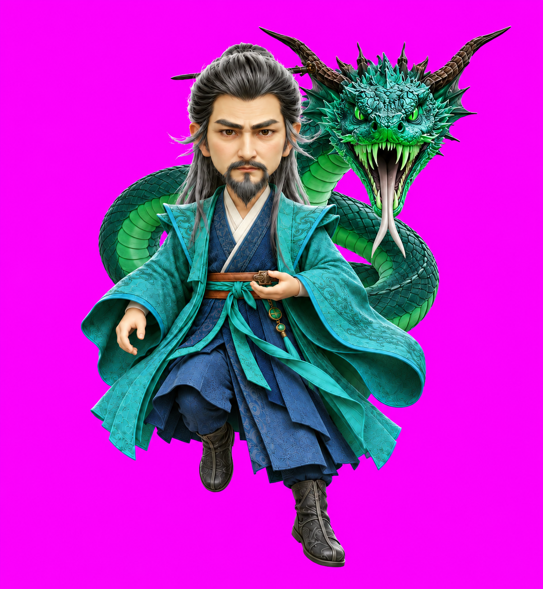

# 魏无涯

《凡人修仙传》动漫魏无涯的 Codex Desktop v2 Q 版桌宠。灰黑长发、灰眉与胡须、青绿宽袖法袍和深色内袍保持统一系列风格；默认脸与身体正对镜头，腰前托掌待机。

## 预览

| 默认待机 | 正面毒蛟站立 |
| --- | --- |
|  |  |


## 动作

| 状态 | 动作 | 帧数 | 预览 |
| --- | --- | ---: | --- |
| `idle` | 正面腰前托掌，轻微呼吸与眨眼 | 6 | [动画](assets/idle.gif) |
| `running-right` | 向画面右侧移动，交替步态 | 8 | [动画](assets/running-right.gif) |
| `running-left` | 向画面左侧移动，单独生成以保留饰品侧别 | 8 | [动画](assets/running-left.gif) |
| `waving` | 克制挥手问候，再恢复站姿 | 4 | [动画](assets/waving.gif) |
| `jumping` | 人物双脚落地，毒蛟正面朝向镜头，在画面右肩后轻微呼吸、口舌变化与盘绕 | 5 | [动画](assets/jumping.gif) |
| `failed` | 含蓄低头、收掌与失落反应 | 8 | [动画](assets/failed.gif) |
| `waiting` | 托掌向前，等待确认或帮助 | 6 | [动画](assets/waiting.gif) |
| `running` | 站定掐指计算，集中处理任务 | 6 | [动画](assets/running.gif) |
| `review` | 抚须托腮，集中审视 | 6 | [动画](assets/review.gif) |

`jumping` 按用户要求定制为站立召蛟：人物正面托掌、双脚落地，毒蛟正面对镜头，蛇身在背后盘绕。毒蛟头位于画面右侧肩后，角低于人物发顶，人物尺度与 `idle` 一致；五帧人物外轮廓高度约 `198 px`，脚底基线一致。[五帧联系条](assets/jumping-standing-final-strip.png)。

16 个观察方向按顺时针排列：000 表示看上，090 看向画面右侧，180 看下，270 看向画面左侧。双脚与下半身稳定，眼睛、头颈、头发和胡须自然响应视线。[方向联系表](assets/look-directions.png) · [连续方向预览](assets/look-directions.gif)。

## 安装

安装文件为本目录的 `pet.json` 与 `spritesheet.webp`。在仓库根目录运行：

```powershell
$petId = "wei-wuya"
$petTarget = Join-Path $HOME ".codex\pets\$petId"
New-Item -ItemType Directory -Path $petTarget -Force | Out-Null
Copy-Item ".\$petId\pet.json", ".\$petId\spritesheet.webp" -Destination $petTarget -Force
```

复制后重启 Codex Desktop，选择魏无涯。

## 规格与检查

- `spriteVersionNumber: 2`；图集 `1536 x 2288`，8 列 x 11 行，单元格 `192 x 208`。
- 9 套标准动作共 57 帧，另含 16 个观察方向与静态 neutral 单元格；未使用格完全透明。
- 使用内置 `imagegen` 生成视觉，`hatch-pet` 确定性脚本处理提取、组装、透明背景与校验。两套方向分别来自完整连续八帧生成。
- v2 图集、透明 RGB、边缘与色键清理校验通过；方向连续性无警告、无透明空洞。
- 三名隔离审阅者的随机 A/B 盲测：14 组方向判断全部通过，无错误、无警告。
- 最终独立视觉 QA 通过；部分相邻斜向姿态差异较细微，方向正确、盲测通过，已审阅接受。

## 形象与源工程

用户于 2026-10-14 批准 [正面默认姿态](assets/base-v2.png)。生产阶段另行生成 [生产基本图](assets/production-base.png)，通过完整性、主体占比和小尺寸可读性检查，统一为纯洋红背景后晋升 canonical。初版 [base.png](assets/base.png) 保留。

本地 `source/wei-wuya-20261014/` 保存选型记录，`source/wei-wuya-20261014-production/` 保存提示词、生成输入、原始行、失败尝试、两版图集与完整 QA。源工程按仓库配置不纳入 Git；旧玄蟒版本与右肩修复记录均保留。最终站立毒蛟版本保存在 `source/wei-wuya-20261014-dujiao-standing-final/`。

## 历史预览：正面毒蛟腾跃版

用户要求毒蛟更接近参考图：脸正对镜头，双角、绿色竖瞳、獠牙与分叉长舌清楚，蛇身在魏无涯背后盘绕；并接受腾跃姿态。



此图保留作历史选型预览，用户随后改为站立。提示词及检查记录保存于本地 `source/wei-wuya-20261014-dujiao-preview/`。

### 五帧 jumping 候选

此腾跃候选保留作历史预览；用户最新要求改为站立，人物双脚落地，仅毒蛟轻微呼吸盘绕。


[五帧联系条](assets/jumping-dujiao-front-strip.png)。动作按蓄势、起跳、腾空、下降、收势展开，毒蛟始终正面朝向镜头、蛇身在人物背后盘绕。使用公共视窗保持人物尺度与腾跃位移，完成提取、边缘处理及候选 v2 校验；保留作历史预览。工程保存在本地 `source/wei-wuya-20261014-dujiao-jumping-preview/`。

### 已批准的站立预览


[五帧联系条](assets/jumping-dujiao-standing-strip.png)。人物正面托掌、双脚落地，仅毒蛟轻微抬首、盘绕和口舌变化，首尾姿态接近。用户于 2026-10-14 批准此造型与动作。该预览保留作选型记录，正式版已压低毒蛟头颈，使人物恢复待机尺度；当前发布预览见上方。预览工程保存在本地 `source/wei-wuya-20261014-dujiao-standing-preview/`，最终修正、图集与独立 QA 保存在 `source/wei-wuya-20261014-dujiao-standing-final/`。
