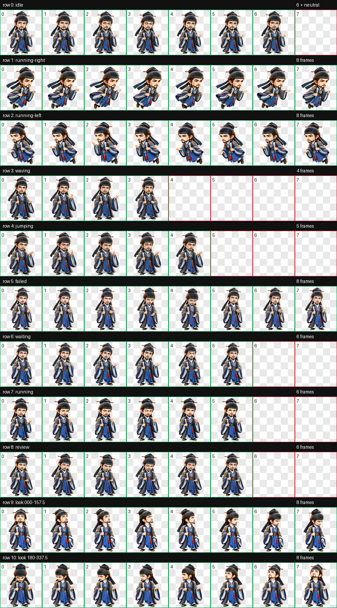

# 仲神师

《凡人修仙传》动漫仲神师的精致中国 3D 动漫 Q 版桌宠，约三头身。保留黑色巾帽与横簪、短须、双耳环、蓝灰法袍、金色肩纹和菱形胸饰。

角色自身右手持合拢银色折扇，左手用于掐指推演。`jumping` 按用户要求改为双脚落地的推演循环，表情随计算从凝神、皱眉思索变化到有所领悟，再回到平静。

## 预览




## 动作

| 状态 | 动作设计 |
| --- | --- |
| `idle` | 持合拢折扇，轻微呼吸、眨眼，左手保持安静姿态 |
| `running-right` / `running-left` | 向对应方向御空滑行，手腕、袖摆与衣摆连续变化，保留折扇右手侧别与人物尺度 |
| `waving` | 左手轻挥致意，右手折扇稳定 |
| `jumping` | 双脚落地，左手掐指推演，眉眼与嘴角随思考变化 |
| `failed` | 推演受阻，眉眼低落，轻微垂首 |
| `waiting` | 期待回应的询问姿态 |
| `running` | 专注处理任务的克制思考姿态 |
| `review` | 凝神检查结果 |
| look directions | 身体下部稳定，眼睛、头颈与上身自然跟随 16 个顺时针方向 |

## 安装

在仓库根目录运行 PowerShell：

```powershell
$petId = "zhong-shenshi"
$target = Join-Path $HOME ".codex\pets\$petId"
New-Item -ItemType Directory -Path $target -Force | Out-Null
Copy-Item ".\$petId\pet.json", ".\$petId\spritesheet.webp" -Destination $target -Force
```

安装目录只需 `pet.json` 与 `spritesheet.webp`。复制后重启 Codex Desktop，在 pet 选择界面选择仲神师。

## 格式与验证

- `spriteVersionNumber: 2`；图集 `1536 × 2288`，8 列 × 11 行，单元格 `192 × 208`。
- `pet.json` 的 `id` 与目录一致，图集使用相对路径 `spritesheet.webp`。
- `validate_atlas.py --require-v2` 通过，无错误或警告；未使用单元格透明。
- 单次确定性透明边缘处理通过，透明像素隐藏 RGB 残留为 0。
- 标准动作、方向语义、连续性和最终视觉 QA 均通过。
- 三组独立方向盲测采用严格多数，14 组测试全部匹配，无错误或警告。
- 接受的轻微视觉说明：292.5° 上左方向的抬眼幅度较克制；行间掌形变化和鞋间透明空隙经视觉检查确认自然，无明显缩放跳变或破损。

## 源文件

2026-10-12 使用内置 imagegen 生成视觉素材，使用 `hatch-pet` 脚本提取、组装和校验。用户确认的候选稿用于锁定身份，正式生产基本图另行生成并通过检查。

生产输入、完整提示词、未采用的生成结果、中间产物和 QA 证据保存在本地 `source/zhong-shenshi-20261012/`。各动作提示词在 `prompts/rows/`，生产基本图提示词为 `prompts/base-pet.md`，最终报告为 `qa/run-summary.json`。仓库配置默认不将 `source/` 纳入发布。
